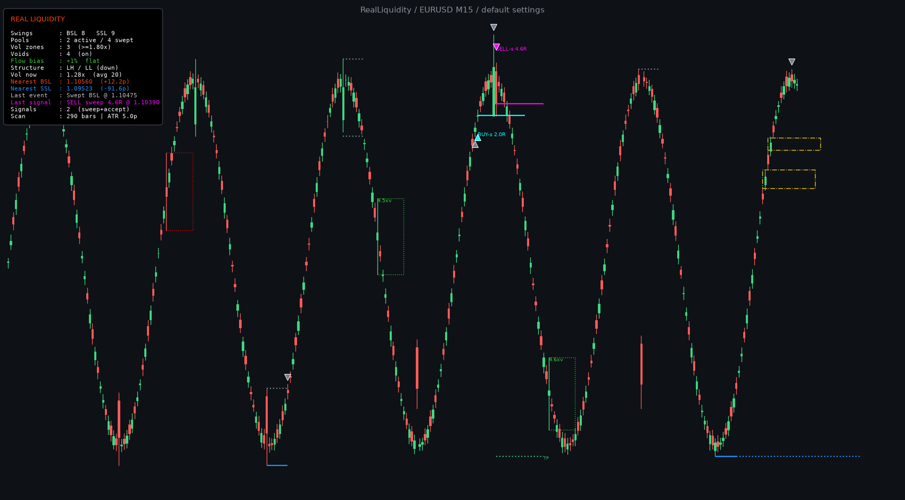

# RealLiquidity — MT4 liquidity mapper

`RealLiquidity.mq4` is a MetaTrader 4 chart indicator that maps **where resting liquidity most likely sits** on the price chart:

* **Buy-side liquidity (BSL)** — stops and breakout orders parked *above* swing highs.
* **Sell-side liquidity (SSL)** — stops parked *below* swing lows.
* **Liquidity pools** — two or more equal / near-equal highs or lows. Everyone's stop sits in the same place, so these act as magnets and as obvious targets for stop hunts.
* **Volume-spike areas** — bars where volume expanded far above its average *and* price actually travelled. This is the closest thing to “institutional activity” a retail MT4 chart can show.
* **Liquidity voids / imbalances** — 3-bar gaps left by an aggressive move; price often returns to rebalance them.
* **Liquidity sweeps** — a wick through a level that closes back inside: a stop-run / liquidity grab, followed by a reversal.
* **Entry signals** — the two tradeable outcomes of the above, with **entry, stop-loss and take-profit** levels and a risk:reward ratio: sweep-reversal entries and pool-acceptance (breakout) entries.



<sub>Rendered from the indicator's own chart objects: outline zones, level lines tied to their structure, compact tags, entry arrows with SL/TP.</sub>

The indicator is **object based** (no indicator buffers), so it works on any symbol and timeframe without touching the chart's indicator list, and it **does not repaint confirmed structure**: a pivot is only used after its right-hand confirmation bars have closed.

```
               ╔══════════════════════════════════════════╗  ← BSL x3  (equal highs + stops)
               ║                                          ║
   highs  ─────╫───┬─────────────┬────────────────┬───────╫──── pool box, extends right
               ╚═══╪═════════════╪════════════════╪═══════╝
                   │             │                │
                   │        ▄▄▄▄▄│▄▄▄▄▄      ▲    │  ← sweep arrow (wick above, close back)
              ▄▄▄▄▄│▄▄▄▄▄  ▄▄▄▄▄▄▄▄▄▄▄▄▄▄▄   ╷
     ┌─────────────┴──────────────────────────┐   ╷  ← volume-spike zone
     │  ███ 6.3x vol                          │   ╷
     └────────────────────────────────────────┘   ╷
                     ▄▄▄▄▄▄▄▄▄▄▄▄▄▄▄▄▄▄▄▄▄▄▄▄▄▄▄▄▄╵
               ╔══════════════════════════════════════════╗  ← SSL x2 (equal lows)
               ║                                          ║
   lows   ─────╚══════════════════════════════════════════╝
```

---

## 1. Installation

1. Copy `RealLiquidity.mq4` to `<MetaTrader 4 data folder>/MQL4/Indicators/`
   (in MT4: **File → Open Data Folder → MQL4 → Indicators**).
2. Open **MetaEditor** (F4), open the file from the Navigator, press **F7** (Compile) — it must report `0 error(s)`.
3. Back in MT4, refresh the Navigator (**right-click → Refresh**), then drag **RealLiquidity** onto a chart.
4. The inputs dialog opens. Defaults are tuned for FX majors on M5–H1; see §3 for other markets.

**Fastest start:** attach it, leave the defaults, and look for the arrows. Every arrow comes with `entry`, `SL` and `TP` lines and a risk:reward ratio, so you can judge a signal without calculating anything.

> **MT4 only.** The file uses the MQL4 object API and the MQL4 `OnCalculate(rates_total, prev_calculated, ...)` signature. It will not compile as-is in MetaTrader 5 (MT5 uses `ENUM_TIMEFRAMES`-based object calls and a different `OnCalculate`).

Removal: detach the indicator; every chart object it created is prefixed `RLQO_` / `RLQP_` and is deleted automatically.

---

## 2. What gets drawn

| On the chart | Meaning |
|---|---|
| **Orange outline box** | Buy-side liquidity pool (≥ `InpMinTouches` equal highs). Stops sit just above the top edge. |
| **Blue outline box** | Sell-side liquidity pool (≥ `InpMinTouches` equal lows). Stops sit just below the bottom edge. |
| **Box covering only part of the chart** | Zones are local to their structure and never stretch across the whole screen (see §4). |
| **Orange / blue dotted line** | A single confirmed swing high/low — one resting level, not a pool. |
| **Gray dashed box + dotted line** | A pool that has already been **swept** (liquidity taken). |
| **Tag `BSL3` / `SSL2`** | Side and number of touches. `BSL3` = buy-side pool, 3 equal highs; a trailing `-` means swept (`BSL2-`). `InpZoneLabels = 2` spells it out. |
| **Green box, `6.3xv`** | Bullish volume-spike area (heavy buying participation). |
| **Red box, `2.1xv`** | Bearish volume-spike area (heavy selling participation). |
| **Gold dash-dot box, `void up/dn`** | Unfilled liquidity void / 3-bar imbalance. |
| **Up / down arrow + `sweep`** | Stop-run: price wicked through a pool and closed back inside. |
| **Dotted horizontal line + `BSL 1.09485 (+5.9p)`** | The **nearest** liquidity level above and below the current price, with distance in pips. |
| **Aqua ▲ `BUY sweep 2.4R E 1.10450`** | Buy entry signal: model, planned risk:reward, entry price. |
| **Magenta ▼ `SELL sweep 1.8R E 1.10250`** | Sell entry signal. |
| **Solid entry line + dotted `SL` / `TP` lines** | Entry, stop-loss and take-profit of the signal, projected right for `InpEntryProjectBars`. |
| **Faint red/green boxes** | Optional risk (entry→SL) and reward (entry→TP) shading. |
| **Panel (top-left)** | Live statistics: swing count, active vs swept pools, volume zones, flow bias, market structure, current volume expansion, nearest levels, last event. |
| **Legend (bottom-left)** | Colour key. |

Nothing is drawn inside the future beyond `InpExtendBars` bars to the right of the current bar.

---

## 3. Inputs

### Detection

| Input | Default | Description |
|---|---|---|
| `InpSensitivity` | `5` | Master dial, 1 = strict … 10 = aggressive. It simultaneously (a) lowers the pivot strength, (b) widens the equal-level tolerance, and (c) lowers the volume-spike threshold. |
| `InpLookbackBars` | `600` | How many bars back to scan. Ignored for pivots older than this. |
| `InpPivotLeft` | `0` | Confirmation bars to the **left** of a swing. `0` = derive from sensitivity. |
| `InpPivotRight` | `0` | Confirmation bars to the **right** (this is the non-repainting delay). `0` = derive from sensitivity. |
| `InpEqualTolPips` | `2.0` | How close two highs/lows must be to count as “equal”. Effective value is scaled by sensitivity (×0.7 … ×1.3). |
| `InpMaxPoolWidthPips` | `5.0` | Hard cap on how tall one pool may grow through clustering. Prevents tolerance chaining from merging unrelated swings into one huge band. `0` = no limit. |
| `InpMinTouches` | `2` | Pivots required before a cluster is treated as a pool (instead of a single swing line). |
| `InpMaxPools` | `6` | Maximum pool zones drawn (strongest/freshest first). |
| `InpMaxSingleLevels` | `0` | Maximum single swing lines. `0` = off, because single swings are the biggest source of clutter. |
| `InpZonePadBars` | `8` | How many bars a zone extends past its **last** touch. |
| `InpZoneMaxBars` | `40` | Zones wider than this are drawn as level lines instead of boxes (a 200-bar cluster otherwise dominates the screen). `0` = always box. |
| `InpExtendBars` | `24` | Projection length used for the nearest level. |
| `InpProjectNearest` | `true` | Project **only** the nearest BSL/SSL level to the live edge, instead of every zone. |
| `InpOnlyActivePools` | `false` | Hide pools that were already swept. |
| `InpShowSweeps` | `true` | Draw sweep arrows. |
| `InpSweepCloseBack` | `true` | Require a close back inside the level for a sweep. `false` = any wick through counts. |

### Volume / order flow

| Input | Default | Description |
|---|---|---|
| `InpVolumeSource` | `Tick volume` | `Tick volume` (default, always available on FX) or `Real volume` (exchange volume; falls back to tick volume automatically if the symbol has none). |
| `InpVolAvgPeriod` | `20` | Average period for the volume baseline. The baseline **excludes the current bar**, so a spike cannot hide itself. |
| `InpVolSpikeMult` | `1.8` | Volume must exceed `baseline × multiplier` to qualify (scaled by sensitivity: ×0.8 … ×1.2). |
| `InpVolMinTicks` | `20` | Bars below this raw volume are ignored (filters thin sessions and rollover). |
| `InpVolZoneATRMult` | `0.60` | The bar's range must be at least this × ATR(14); a volume spike with no price travel is just noise. |
| `InpVolZoneUseBody` | `false` | Zone = candle body instead of the full high–low range. |
| `InpMaxVolZones` | `4` | Maximum volume zones drawn (newest first). |
| `InpVolZoneExtend` | `10` | Length of a volume zone, in bars. |
| `InpFlowBars` | `50` | Bars used for the flow-bias estimate (see §5). |

### Liquidity voids

| Input | Default | Description |
|---|---|---|
| `InpShowVoids` | `true` | Draw 3-bar voids/imbalances. |
| `InpVoidMinATR` | `0.35` | Minimum gap size as a fraction of ATR(14). |
| `InpMaxVoids` | `3` | Maximum voids drawn. |
| `InpVoidExtendBars` | `20` | Length of a void box, in bars. |
| `InpHideFilledVoids` | `true` | Hide voids that price has already traded back through. |

### Entry signals

| Input | Default | Description |
|---|---|---|
| `InpShowEntries` | `true` | Master switch for entry signals. |
| `InpEntrySweep` | `true` | **Sweep-reversal** model: pool swept + next bar closes beyond the sweeping bar's opposite extreme. |
| `InpEntryBreakout` | `true` | **Pool-acceptance** model: two consecutive closes beyond a pool level with no close back inside. |
| `InpEntryConfirmBars` | `1` | Bars after the sweep before the confirmation bar is evaluated. `1` = the very next bar. |
| `InpEntrySLBufferATR` | `0.25` | Stop distance beyond the sweep wick / pool edge, as a fraction of ATR. A minimum of 2 pips always applies. |
| `InpEntryTPMode` | `2` | `0` = nearest pool only (skip if RR too small), `1` = fixed RR, `2` = pool if the RR is acceptable, otherwise fixed RR. |
| `InpEntryRR` | `2.0` | Fixed risk:reward used for the fallback target. |
| `InpEntryMinRR` | `1.0` | A pool target is only accepted if it yields at least this RR. |
| `InpEntryMaxSignals` | `6` | Maximum signals drawn (newest first). |
| `InpEntryLookback` | `300` | Signals older than this many bars are dropped. |
| `InpEntryMaxRiskATR` | `6.0` | Reject signals whose stop is wider than this many ATRs. Keeps outlier wick-sweeps out and prevents SL/TP lines spanning the whole screen. `0` = off. |
| `InpEntryProjectBars` | `18` | How far the entry/SL/TP lines are projected to the right. |
| `InpEntryShowLevels` | `true` | Draw the entry, SL and TP lines with price labels. |
| `InpEntryShowZones` | `false` | Shade the risk and reward areas. |
| `InpEntryVolFilter` | `false` | Require volume expansion on the sweep and confirmation bars. |
| `InpEntryVolMult` | `1.2` | Volume multiple required when the filter is enabled. |
| `InpColorBuy` | `Aqua` | Buy entry arrow/label. |
| `InpColorSell` | `Magenta` | Sell entry arrow/label. |
| `InpColorSL` | `Red` | Stop-loss line. |
| `InpColorTP` | `MediumSeaGreen` | Take-profit line. |

### Visuals

| Input | Default | Description |
|---|---|---|
| `InpShowPanel` | `true` | Top-left information panel. |
| `InpShowLegend` | `false` | Bottom-left legend. Off by default: the tags are self-explanatory. |
| `InpShowNearest` | `false` | Extra dotted lines for the nearest liquidity (the panel already prints both distances). |
| `InpFontSize` | `8` | Base font size. |
| `InpZoneFill` | `false` | Shade zones. Off = outline only, so candles stay readable. |
| `InpZoneLabels` | `1` | Zone tags: `0` none, `1` compact (`BSL3`, `4.6xv`), `2` full words. |
| `InpSweepLabels` | `false` | Print the word "sweep". Off = arrow only, which is enough. |
| `InpEntryLevelLines` | `2` | Only the newest N signals get entry/SL/TP lines; older ones keep the arrow. |
| `InpLabelDensity` | `1` | Minimum vertical spacing between tags: `1` tight, `2` normal, `3` airy. |
| `InpColorBSL` | `OrangeRed` | Buy-side liquidity. |
| `InpColorSSL` | `DodgerBlue` | Sell-side liquidity. |
| `InpColorBull` | `LimeGreen` | Bullish volume spike. |
| `InpColorBear` | `Red` | Bearish volume spike. |
| `InpColorVoid` | `Gold` | Void / imbalance. |
| `InpColorSwept` | `SlateGray` | Already-swept liquidity. |
| `InpColorText` | `Silver` | Chart labels. |
| `InpColorPanelBg` | `Black` | Panel background. |
| `InpColorPanelTx` | `White` | Panel text. |
| `InpColorPanelBorder` | `DimGray` | Panel border. |

### Alerts

| Input | Default | Description |
|---|---|---|
| `InpAlertSweep` | `true` | Alert when a pool is swept on the last closed bar. |
| `InpAlertEntry` | `true` | Alert with entry / SL / TP when a new entry signal confirms. |
| `InpAlertApproach` | `false` | Alert when price comes within `InpAlertDistPips` of the nearest liquidity. |
| `InpAlertDistPips` | `5.0` | Approach distance. |
| `InpAlertPush` | `false` | Also send a push notification (MetaQuotes ID required). |
| `InpAlertSound` | `false` | Play `alert2.wav`. |

Alerts are evaluated **once per new bar**, never on the first calculation after attaching, and never on every tick.

---

## 4. Clean by default

The indicator is tuned to stay readable, not to show everything it can find. Five rules do the work:

1. **Outline, not fill.** Zones are drawn as thin rectangles so candles remain visible. `InpZoneFill = true` restores MT4-style shading.
2. **Nothing spans the chart.** A zone starts at its first touch and ends `InpZonePadBars` bars after its last one. Clusters wider than `InpZoneMaxBars` degrade to a level line instead of a giant box.
3. **Zones claim space.** Every volume zone and void must pass an overlap test against zones already drawn (same time window, more than 55 % shared vertical area + a margin) — so price areas with five stacked imbalances show one, not five. Newest wins.
4. **Tags are de-duplicated.** Each tag tests for vertical room (`InpLabelDensity`) before printing. Entry tags claim space first, then pool tags, then volume tags. Compact text (`BSL3`, `BSL2-` for swept, `4.6xv`) keeps them small.
5. **History is quiet.** Swept pools lose their box and tag and keep only the arrow. Only the nearest level is projected to the live edge (`InpProjectNearest`), and only the newest `InpEntryLevelLines` signals keep their SL/TP lines.

Measured on a busy synthetic chart: **chart objects 65 → 19, overlapping tags 11 → 0**, with no loss of the information that matters (active pools, sweeps, entries).

### If you want it busier or quieter

| Goal | Change |
|---|---|
| Quieter still | `InpZoneLabels = 0`, `InpShowVoids = false`, `InpMaxPools = 4`, `InpLabelDensity = 3` |
| Show only live liquidity | `InpOnlyActivePools = true`, `InpShowSweeps = false` |
| Focus on entries only | `InpZoneLabels = 0`, `InpMaxVolZones = 2`, `InpMaxVoids = 0`, `InpShowPanel = false` |
| Everything visible (old look) | `InpZoneFill = true`, `InpZoneLabels = 2`, `InpZoneMaxBars = 0`, `InpMaxSingleLevels = 10`, `InpShowNearest = true`, `InpEntryLevelLines = 6` |
| Colours for a white chart | `InpColorText = clrBlack`, `InpColorPanelBg = clrWhite`, `InpColorPanelTx = clrBlack`, `InpColorPanelBorder = clrSilver` |

---

## 5. Suggested settings per market

| Market / TF | Sensitivity | Lookback | Equal tolerance | Volume mult | Notes |
|---|---|---|---|---|---|
| FX majors, M5–M15 | 5–6 | 600–900 | 2.0 | 1.8 | Defaults. Tick volume is meaningful. |
| FX majors, H1–H4 | 4–5 | 400–600 | 2.5–3.0 | 1.6 | Wider tolerance because swings are wider. |
| Gold (XAUUSD) | 5 | 500 | 3.0–5.0 (0.30–0.50 in price) | 2.0 | Pip size auto-detects 0.10 on 2-digit quotes. |
| Indices / CFDs | 4 | 500 | 4.0–6.0 | 1.5 | Prefer `Real volume` if your broker provides it. |
| Crypto CFDs | 6 | 800 | 3.0 | 2.0 | Tick volume is noisy; raise the multiplier. |
| Futures (if broker offers) | 5 | 600 | 2.0 | 1.5 | Switch `InpVolumeSource` to `Real volume`. |

For entries specifically: `InpEntryTPMode = 1` with `InpEntryRR = 2.0` gives the cleanest, most frequent signals (no dependency on a pool being reachable); `mode 2` gives higher-quality but rarer ones. Leave `InpEntryVolFilter` off until you have watched the arrows for a week.

If the chart is too busy: raise `InpSensitivity`? **No** — lower it (strict), reduce `InpMaxPools` / `InpMaxSingleLevels`, or enable `InpOnlyActivePools`.
If the chart is too empty: raise sensitivity, widen `InpEqualTolPips`, or increase `InpLookbackBars`.

---

## 6. How the calculation works

1. **Pivot detection**
   Fractal pivots with `L` bars to the left and `R` bars to the right (strict inequality on both sides). A pivot at bar *i* is only created once bars *i−1 … i−R* have closed, which is why the structure does not repaint.

2. **Clustering into pools**
   Pivots of the same type are merged when they are within the equal-level tolerance of the pool's current extreme, and when the resulting band stays inside `InpMaxPoolWidthPips`. A cluster with ≥ `InpMinTouches` members becomes a **pool**; the rest are drawn as single levels.
   `level` = the highest high (BSL) or lowest low (SSL) in the cluster — the exact price where stops would sit.
   `top`/`bottom` describe the band of highs/lows that formed the cluster.

3. **Sweep detection**
   Starting from the bar where the pool's newest pivot was confirmed, each newer bar is tested:
   * BSL swept when `high > level` **and** `close < level` (when `InpSweepCloseBack = true`);
   * SSL swept when `low < level` **and** `close > level`.
   The first such bar is stored (`tSwept`, `sweepPrice`), and the pool is rendered gray with an arrow.

4. **Volume spikes**
   Baseline = mean tick (or real) volume of the `N` bars **before** the bar being tested. A bar qualifies when
   `volume ≥ baseline × multiplier` **and** `volume ≥ InpVolMinTicks` **and** `range ≥ ATR(14) × InpVolZoneATRMult`.
   Direction comes from the close-location value (below).

5. **Flow-bias proxy (order-flow estimate)**
   MQL4 has no access to the order book, so a directional delta is estimated per bar:

   ```
   CLV   = (close - low) / (high - low)        // 0 … 1, where the bar closed in its range
   delta = (2 × CLV - 1) × volume              // signed volume proxy
   bias% = sum(delta, last InpFlowBars) / sum(volume, last InpFlowBars) × 100
   ```

   `+100%` = every bar closed on its high, `-100%` = every bar closed on its low. The panel shows `Flow bias: +23% buyers` and colours it green/red. Treat it as a **sentiment proxy**, not as exchange order flow.

6. **Market structure**
   The last two swing highs and the last two swing lows produce `HH/HL (up)`, `LH/LL (down)`, `HH/LL (expansion)` or `LH/HL (contraction)`.

7. **Voids**
   A bullish void exists when `low[i] > high[i+2]` and the gap is at least `ATR × InpVoidMinATR`; a bearish void when `high[i] < low[i+2]`. A void is *filled* once any later bar trades back into it.

---

## 7. Entry signals

Two models, both evaluated **on closed bars only** and never re-evaluated on ticks.

### A. Sweep reversal (`reason = sweep`)

1. A pool (≥ `InpMinTouches` equal highs/lows) gets swept: `high > level` **and** `close < level` (mirrored for lows).
2. On the confirmation bar — `InpEntryConfirmBars` bars after the sweep — the close must break the **sweeping bar's opposite extreme**:
   * BSL sweep → short when `close < low(sweep bar)`;
   * SSL sweep → long when `close > high(sweep bar)`.
3. **Entry** = that confirmation close. **Stop** = beyond the sweep wick + `ATR × InpEntrySLBufferATR`. **Target** = nearest active pool in the trade direction, or the fixed RR.

### B. Pool acceptance (`reason = accept`)

1. A pool that was *not* swept gets two consecutive closes beyond its level — the market accepted the price, it did not just wick through.
2. **Entry** = the second (newest) of those closes. **Stop** = the opposite edge of the pool band − buffer. **Target** = next pool in the direction of the trade, or the fixed RR.

### Take profit selection

```
poolTp = nearest active pool of the same kind as the trade direction
         (RSL above for a long, SSL below for a short)

mode 0 : use poolTp, skip the signal if it yields < InpEntryMinRR
mode 1 : always use entry ± risk × InpEntryRR
mode 2 : use poolTp if its RR >= InpEntryMinRR, otherwise the fixed RR
```

If no pool is available in the trade direction, modes 1 and 2 fall back to the fixed RR target; mode 0 skips the signal.

### Rules the signals obey

* **One signal per bar** — if two pools trigger on the same bar, the stronger one (more touches, then higher RR, then sweep over acceptance) is kept.
* **Valid geometry only** — a signal is discarded unless `SL < entry < TP` (long) or `TP < entry < SL` (short).
* **Non-repainting** — a signal appears on a bar that has already closed and stays there.
* **Capped and aged** — at most `InpEntryMaxSignals`, nothing older than `InpEntryLookback` bars.

The panel row **`Last signal`** always shows the most recent one, e.g. `BUY sweep 2.4R @ 1.10450`.

---

## 8. Reading the chart — practical use

**Liquidity as a magnet.** Price is usually drawn to the nearest pool: stops above equal highs are fuel for a move up, stops below equal lows for a move down. The nearest-level lines show how many pips away that fuel is.

**Sweep → reversal.** The classic setup this indicator highlights:
1. A BSL/SSL pool is marked (two or more equal highs/lows).
2. Price wicks through it and **closes back inside** → the pool turns gray, a `sweep` arrow appears, and the panel's last event reads `Swept BSL @ …`.
3. Look for a reversal entry against the sweep, ideally confirmed by a volume-spike zone in the reversal direction, and target the opposite pool.

**Pool → continuation.** If price pushes through a pool and *closes* beyond it (`InpSweepCloseBack` blocks the sweep flag when the close is outside), treat it as acceptance, not rejection.

**Voids as rebalance targets.** Unfilled gold boxes are areas price left too fast; they often get revisited. They work well as take-profit zones.

**Structure + flow alignment.** `HH/HL (up)` plus a positive flow bias plus an untouched BSL pool above is a coherent long-side picture; conflicting readings are a reason to stand aside.

**Confluence is the point.** A zone where a volume spike, a pool and a void overlap is far more meaningful than any single marker.

---

## 9. Notes, limitations, troubleshooting

* **“Real” liquidity is inferred, not observed.** MT4 is a retail charting terminal: it exposes OHLC and tick volume only, with no DOM, no depth-of-market and no per-order data. True order-flow analysis needs a futures/exchange feed (e.g. CME datamine, Bookmap, Sierra Chart) or broker-side depth. This indicator reconstructs the *most probable* resting-liquidity locations from price structure and volume proxies, which is what the concept is based on in practice. If your broker supplies exchange volume (some do for futures), switch `InpVolumeSource` to `Real volume`.
* **Tick volume ≠ traded contracts.** On FX it is the number of price updates in a bar and correlates well with activity, but it is not contract volume.
* **No repainting of confirmed pivots** — but the right-most bars are by definition not yet confirmed, so zones can appear/disappear near the live edge. This is normal and matches how structure forms.
* **Objects, not buffers** — you cannot `iCustom()` the values from an EA as indicator buffers. If you need EA access, read the chart objects by their `RLQO_` prefix (e.g. `ObjectGetDouble` on the `RLQO_LVL_*` trend lines).
* **Performance:** analysis runs on new-bar events (and on history refresh), not on every tick; only the panel is refreshed per tick. A typical chart holds ~50–150 objects.
* **Not enough bars:** below 100 bars loaded the indicator stays silent.
* **Nothing appears:** check that the chart is not in a weekend/flat period, lower `InpSensitivity` (more strict → fewer, but also check the opposite direction), raise `InpLookbackBars`, and confirm the timeframe has visible swings.
* **Too many boxes:** set `InpOnlyActivePools = true`, lower `InpMaxPools`/`InpMaxSingleLevels`, or raise `InpMinTouches` to 3. See §4 for the full clean-up table.
* **Tags missing:** that is the de-duplication working — two levels at the same price only get one tag. Lower `InpLabelDensity` to 1 to allow more.
* **Alerts fire once per bar**, on the bar that completes, using the last closed bar's sweep or entry.
* **No entry arrows:** they need a confirmed sweep or acceptance plus a valid target. Try `InpEntryTPMode = 1` (fixed RR) to remove the pool-target requirement, raise `InpEntryMaxSignals`, or increase `InpEntryLookback`. With `InpEntryVolFilter = true` on quiet symbols you may get none — turn it off first.
* **Testing:** the MQL4 source was verified with a C++/ASan harness (240 randomized parameter/bar-count cases plus targeted tests for pool detection, sweeps, volume zones, both entry models, signal geometry, and object lifecycle). Always compile in MetaEditor for your own build.

---

## 10. File layout

```
RealLiquidity.mq4   the indicator (single file, no dependencies)
README.md           this document
docs/preview.png    rendering of the indicator's own chart objects
```

## 11. Disclaimer

Trading involves substantial risk. This tool is an analysis aid, not a signal service, and it is provided **as is**, without warranty of any kind. Past behaviour of liquidity zones does not guarantee future results. Test on a demo account before using it with real money.
