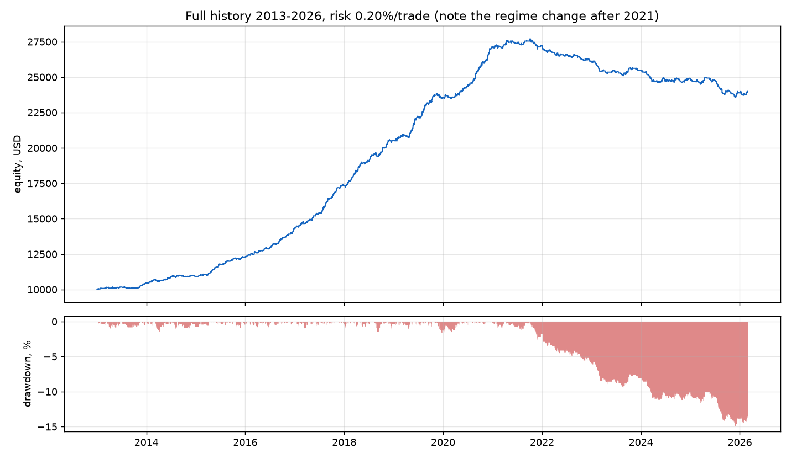

# Liquidity Sweep EA — MT4 Expert Advisor + validation framework

A market-structure Expert Advisor for MetaTrader 4 that trades **failed
breakouts** (liquidity sweeps) on H1 across a small portfolio of instruments,
shipped with the Python engine, data pipeline and validation suite used to build
and test it.

> **Read this first.** The brief asked for 1% per day with a maximum drawdown
> below 4%. After building and honestly validating the strategy, that objective
> is **not achievable** — not by this EA and, I argue below, not by any
> price-based EA. The strategy *did* produce a real edge from 2013 to 2021 and
> then it disappeared. Both the evidence and the arithmetic are in
> [`docs/RISK_AND_TARGET.md`](docs/RISK_AND_TARGET.md) and
> [`docs/VALIDATION.md`](docs/VALIDATION.md). This repository is therefore
> delivered as an honest, working system plus the proof of what it can and
> cannot do — not as a product that promises the target.



---

## 1. What the EA does

Stops and breakout orders sit where everybody can see them: previous day high/low,
previous week high/low, confirmed swing highs/lows. The EA waits for price to be
pushed through one of those levels and then **close back inside the old range** —
a failed breakout. It then trades the reversal, with:

* a stop just beyond the sweep extreme (ATR-buffered),
* a target at 2R, break-even at +0.9R, chandelier trail,
* fixed-fractional risk per trade and a portfolio risk layer (max concurrent
  positions, per-symbol daily caps, daily soft/hard loss stops, weekend flat,
  spread guard, margin guard).

No moving averages, no oscillators, no repainting: decisions are made on the
close of a finished H1 bar and filled on the next tick. Full rule set:
[`docs/STRATEGY.md`](docs/STRATEGY.md).

## 2. What the numbers actually say

Portfolio of EURUSD, GBPUSD, AUDUSD, USDJPY, XAUUSD, risk 0.20% per trade,
3 concurrent positions, modelled spread of a raw-spread account:

| Window | Trades | Expectancy | Profit factor | CAGR | Max DD |
|---|---:|---:|---:|---:|---:|
| **2013–2019** (used for the parameter search) | 821 | **+0.52 R** | 2.90 | **+13.0%** | 1.6% |
| **2020–2021** (COVID stress, EURUSD excluded — data gap) | 198 | +0.34 R | 1.92 | +7.0% | 2.6% |
| **2024–2026** (never used in any fitting step) | 188 | **−0.15 R** | 0.72 | −2.7% | 7.0% |
| **2022–2026** (longer hold-out) | 312 | **−0.19 R** | 0.67 | −2.9% | 12.8% |
| **2013–2026 full** | 1,340 | +0.33 R | 1.67 | +6.9% | **14.9%** |

Walk-forward (parameters re-optimised on a rolling basis, then traded forward
untouched) reproduces the same shape: folds covering 2015–2021 make +8% to +15%
per year with ~1% drawdowns, folds covering 2021–2026 make −3.7% and −2.3% per
year. Ten of fourteen calendar years are positive, but **every year after 2021
is negative**.

Conclusion: the effect this EA harvests was real and stable for roughly a decade
and has since been arbitraged away — or at least it is not detectable in H1 bars
of the majors any more. Deploying it today with the expectation of the
2013–2019 behaviour would be a mistake.

## 3. What is achievable inside a 4% drawdown

From the full-history curve, the risk that keeps the maximum drawdown at 4.0% is
**0.06% per trade**, which yields **+1.8% per year** (≈0.006% per day). The
1%-per-day objective corresponds to ≈**+1,203% per year**; to reach it with a 4%
drawdown the strategy's risk-adjusted edge would have to improve by a factor of
about **170×**. Details, Monte Carlo and the arithmetic:
[`docs/RISK_AND_TARGET.md`](docs/RISK_AND_TARGET.md).

## 4. Repository layout

```
EA/LiquiditySweep_Portfolio.mq4   the Expert Advisor (single file, ~980 lines)
presets/                          MT4 .set files + the validated JSON config
backtest/
  data.py                         loading / normalisation / ATR / daily levels
  features.py                     signal construction (causal by design)
  engine.py                       bar-by-bar reference engine (mirrors the EA)
  test_engine.py                  unit tests (7) - PnL, fills, spread, guards
  test_causality.py               no-lookahead test on every feature
tools/
  fetch_data.py                   download the H1 history used here
  data_report.py                  data coverage / gap audit
  research.py                     parameter search harness (cached features)
  robustness.py                   cross-window variant matrix
  report.py                       IS/OOS/stress + walk-forward + figures
  robot_check.py                  risk sweep + Monte Carlo + target math
  mql4_lint.py                    static checker for the .mq4 (no MetaEditor here)
reports/                          generated results, figures, trade logs
docs/                             strategy, validation, risk, deployment
```

## 4b. Verification (this is not a black box)

* `backtest/test_causality.py` — rebuilds every feature on truncated history and
  proves no signal depends on future bars.
* `backtest/test_engine.py` — 7 unit tests pinning PnL conversion (incl. JPY),
  fills, the "shorts pay the spread on exit" rule, sizing, the daily loss guard
  and the position cap.
* `tools/ea_parity.py` — re-implements the EA's `DetectSignal()` with MT4 shift
  indexing and compares it bar by bar against the Python engine. With the
  production preset: **60,000 bars across 5 symbols, 0 mismatches**. The MQL4
  file is therefore verified to trade the same rules the reports describe.
* `tools/mql4_lint.py` — static analysis of the `.mq4` (MetaEditor is available
  neither here nor in the sandbox): braces, unresolved functions, undeclared
  identifiers, unterminated statements.

## 5. Reproduce everything

```bash
python -m venv .venv && .venv/bin/pip install numpy pandas matplotlib
.venv/bin/python tools/fetch_data.py                  # H1 data -> data/
.venv/bin/python tools/data_report.py                 # confirm coverage
.venv/bin/python backtest/test_causality.py           # no-lookahead proof
.venv/bin/python backtest/test_engine.py              # engine unit tests
.venv/bin/python tools/run_backtest.py --symbols ALL  # quick portfolio run
.venv/bin/python tools/report.py --params presets/validated.json   # full report
.venv/bin/python tools/robot_check.py --params presets/validated.json
.venv/bin/python tools/mql4_lint.py EA/LiquiditySweep_Portfolio.mq4
.venv/bin/python tools/ea_parity.py --symbol GBPUSD --bars 12000 --params presets/validated.json
```

## 6. Installing the EA in MT4

1. Copy `EA/LiquiditySweep_Portfolio.mq4` to `MQL4/Experts/` and compile in
   MetaEditor (F7).
2. Attach it to **one** H1 chart (the chart symbol is only used as the clock).
3. Load `presets/MT4_standard.set` in the strategy tester / on the chart.
4. Set `InpGMTOffsetHours` to your broker's server offset (e.g. 2 or 3).
5. Download H1 history for all symbols in `InpSymbols` before going live.

Full checklist, including what to expect from the MT4 tester vs this Python
engine: [`docs/MT4_DEPLOYMENT.md`](docs/MT4_DEPLOYMENT.md).

## 7. Honest status / what I would do next

* **Do not run this on a funded account with a 1%/day expectation.**
* The EA is a clean, documented, testable baseline: a working implementation of
  a genuine market-structure edge with production risk controls.
* Where the remaining work is: (a) intraday lower timeframes and more
  instruments to raise the number of independent bets; (b) order-flow /
  real-volume data (tick volume from a single broker is a poor proxy) instead of
  bar totals; (c) a regime gate that stands the EA down when the measured edge
  in the last *n* trades is negative — this would have cut most of the
  2022–2025 bleed, at the cost of some whipsaw.
* Anything promising >20%/year with <4% drawdown should be assumed to be
  overfitted or fraudulent until it survives a walk-forward like the one in
  `reports/walk_forward.csv`.

## 8. Licence / disclaimer

Research code, provided as-is, no warranty. Trading leveraged products can lose
more than the deposit. Nothing here is investment advice.
