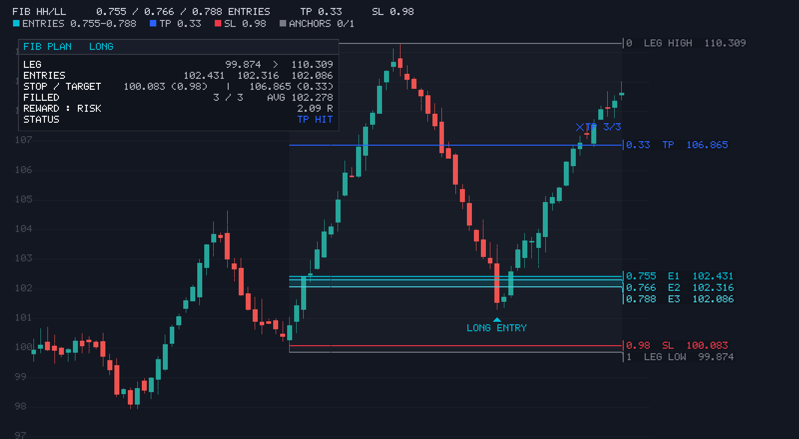

# Fib HH/LL — retracement trade plan (Pine Script v6)

TradingView indicator built from the fib settings in the attached MT5 *Fib retracement* dialog:

| level | role |
|---|---|
| **0.755 · 0.766 · 0.788** | the three entry limits (a 3-step ladder) |
| **0.33** | take profit |
| **0.98** | stop loss |
| 0 · 1 · 1.618 · 2.618 | available, hidden by default (toggle in *② Fibonacci levels*) |

Setups are only taken in the direction of the prevailing structure: **higher high + higher low → long**,
**lower low + lower high → short**.



## Install

1. Open TradingView → **Pine Editor** → *Open* → *New indicator*.
2. Paste the whole content of [`fib_hh_ll_signals.pine`](fib_hh_ll_signals.pine).
3. **Save**, then **Add to chart**.
4. (Optional) *Create alert* → Condition = this indicator → pick one of the four alert events,
   then *Once per bar close* (recommended) or *Once per bar*.

## How the levels are read

The indicator measures the fib **as a retracement from the leg's last extreme** — this is the only
reading in which all three of your roles stay linear (≈ 2.1 R:R with your numbers):

```
LONG   leg = swing low → swing high
       price(level) = legHigh − level × (legHigh − legLow)
       0.755 / 0.766 / 0.788 → entries (deep pullback into the zone)
       0.98                  → stop loss   (just above the swing low)
       0.33                  → take profit (upper part of the leg)

SHORT  leg = swing high → swing low
       price(level) = legLow + level × (legHigh − legLow)
       0.755 / 0.766 / 0.788 → entries (rally into the zone)
       0.98                  → stop loss   (just below the swing high)
       0.33                  → take profit (lower part of the leg)
```

Worked example — leg 100 → 110:

| | long | short |
|---|---|---|
| entries | 102.45 / 102.34 / 102.12 | 107.55 / 107.66 / 107.88 |
| stop (0.98) | 100.20 | 109.80 |
| target (0.33) | 106.70 | 103.30 |
| R:R | 2.09 | 2.09 |

If a tool you compare against counts from the leg **origin** instead, turn on
**“Flip levels”** — every level, label, marker and alert follows the switch, so both conventions
are one click apart.

## Signal logic

1. **Swings** — `ta.pivothigh` / `ta.pivotlow` with configurable left/right bars. A setup appears
   only after the right-hand bars closed, so *nothing repaints*.
2. **Structure** — a setup arms only on HH + HL (long) or LL + LH (short). The pivots are also
   labelled on the chart.
3. **Anchor leg** — the newest impulse leg (opposite extreme → newest pivot). Legs older than
   *Maximum leg length* are ignored.
4. **Entry** — when 0.755 is touched the ladder opens; while the ladder window (default 10 bars)
   is open, 0.766 and 0.788 are filled from the same extreme, so the average fill and the R:R in
   the dashboard update live.
5. **Exit** — 0.33 = TP, 0.98 = SL, checked from the fill bar onward. Inside one candle the **stop
   wins**, which keeps the marker sequence honest.
6. **Expiry** — a setup that is never filled is cancelled after *Cancel after* bars, or immediately
   if price hits the stop side before the fill.

Trade state machine: `idle → waiting for entry → in trade → TP / SL` (or `cancelled`).

## Inputs

| group | input | default | what it does |
|---|---|---|---|
| ① Structure | Pivot left / right bars | 5 / 5 | swing sensitivity |
| | Require structure | on | off = every confirmed impulse leg arms a fib |
| | Maximum leg length | 150 | ignore stale swings |
| | Cancel an unfilled setup after | 120 | expiry in bars |
| | Bars allowed to complete the ladder | 10 | fill window for 0.766 / 0.788 |
| | Trade | Both | longs only / shorts only |
| ② Levels | Entry 1 / 2 / 3 | 0.755 / 0.766 / 0.788 | entry ladder + colours |
| | Take profit | 0.33 | target |
| | Stop loss | 0.98 | stop |
| | Show anchors / extensions | off | 0 · 1 · 1.618 · 2.618 lines |
| | Flip levels | off | anchor 0 % at the leg origin instead |
| ③ Style | Levels line / Extend | Solid / Don't extend | straight from the MT5 *Style* column |
| | Labels, prices, tags, zone fill, dimming | on | chart cosmetics |
| ④ Signals | Entry trigger | Touch | wick into 0.755, or a close inside the zone (optional candle confirmation) |
| | Dashboard corner | Top right | move it out of the way on small screens |
| | Alert on | bar close | or the first tick of the bar (intra-bar) |

## Alerts

Four events are exposed, each with a plain-text `alert()` message and an `alertcondition()`:

- **entry tapped** — direction, zone, SL and TP prices
- **take profit reached** — level, fills used, average entry, R multiple
- **stop loss reached** — level, fills used, average entry
- **setup cancelled** — leg range, reason (no fill in time / stop side hit first)

Alert on *Once per bar close* to match the chart markers one-to-one; *Once per bar* gives the
first tick of the bar that triggers.

## Preview files

| file | what it is |
|---|---|
| `preview/fib_preview.png` | rendered picture of the indicator (levels, zone, ladder tap, TP marker, dashboard) |
| `preview/fib_preview.html` | same picture as a browsable page |
| `preview/generate_preview.py` | independent re-implementation of the level maths + signal state machine on synthetic candles |
| `preview/render_png.py` | dependency-free rasteriser that draws `fib_preview.png` |

The preview scripts mirror the Pine logic (same fib formula, same arming/fill/exit rules) and are
how the numbers in the table above are verified: `python3 preview/generate_preview.py`,
`python3 preview/render_png.py` — standard library only, no dependencies.

> This is a chart tool, not financial advice. Levels and structure logic are fully configurable;
> test on your own market and timeframe before trading it.
