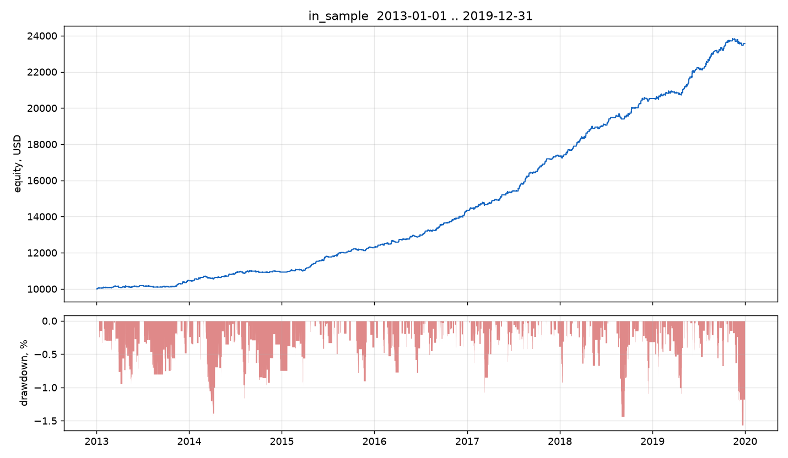

# Validation report

Everything below is reproducible with the scripts in `tools/` and the data
fetched by `tools/fetch_data.py`. Numbers are for the portfolio
**EURUSD, GBPUSD, AUDUSD, USDJPY, XAUUSD**, risk **0.20%** per trade, max 3
concurrent positions, unless stated otherwise.

---

## 1. Data

* H1 OHLCV, UTC timestamps, 2010–2026 (EURUSD from 2006).
* Source: public OHLCV export mirrored in `simonnmarket/OMEGA_OS_Kernel`
  (Dukascopy-derived), fetched by `tools/fetch_data.py`, **not** committed.
* Audit (`tools/data_report.py`):

| Symbol | Bars | Coverage issue |
|---|---:|---|
| EURUSD | 99,999 | **partial hole 2020–2023** (~260 bars/year instead of ~6,200) |
| GBPUSD | 99,999 | complete from 2010-03 |
| AUDUSD | 99,999 | complete from 2010-03 |
| USDJPY | 99,999 | complete from 2010-03 |
| XAUUSD | 68,789 | daily-ish before 2016; H1 complete from 2016 |

Consequences, stated up front:

* EURUSD is excluded from the 2020–2021 stress window (its data there is not
  usable). It is included in the 2013–2019 and 2022–2026 windows, where its H1
  series is complete.
* Gold is only used from 2016 onward; the 2013–2019 in-sample window therefore
  contains gold from 2016.
* No interpolation, no gap filling. Missing bars simply mean no signal.

## 2. Methodology

1. **Causality first.** `backtest/test_causality.py` rebuilds every feature on
   truncated history and compares it to the full-history value at the same bar.
   A lookahead bug fails the build. It passes.
2. **Event-driven engine.** Signals are evaluated on the close of bar *i* and
   filled at the open of bar *i+1*. Stops and targets are checked in a fixed
   order (gap → stop → target → bar-close management) and the stop is assumed to
   be hit before the target when both are inside one bar. Equity is marked to
   market on every bar, so drawdown includes floating risk.
3. **Costs.** Spread is charged on both legs in the direction that hurts:
   longs enter at Ask and exit at Bid; shorts enter at Bid and exit at Ask, i.e.
   a short's stop triggers one spread *before* the bid chart reaches the level.
   A raw-spread account is assumed: EURUSD 0.8 pips, GBPUSD/AUDUSD 0.9, USDJPY
   0.8, XAUUSD 2.5 (spread + commission equivalent).
4. **Split.** Parameters were searched on **2013–2019** only. The
   **2024–2026** window was not used for any fitting decision. **2022–2026** is
   reported as a second, longer out-of-sample block, and 2020–2021 as a
   stress window.
5. **Walk-forward.** Anchored, 5 folds. In each fold the trade-management
   parameters are re-optimised on all data before the fold, then traded forward
   untouched.
6. **Unit tests.** `backtest/test_engine.py` (7 tests) pins PnL conversion
   (including JPY), target/stop fills, the "shorts pay the spread on exit" rule,
   position sizing, the daily loss guard, the max-position cap and the absence of
   lookahead in the engine itself.

### A bug worth reporting

The first version of the engine had inverted stop/target conditions for **short**
positions (it compared the bid open to the stop instead of the Ask, and
double-counted the spread on exit). It made shorts exit early at the open price
and inflated results by roughly +1.5% CAGR and, more importantly, understated
drawdown by 2–3×. It was found while writing the "shorts stop out at Ask" unit
test, fixed, and **every grid search, backtest and report in this repository was
re-run afterwards**. The pre-fix results are not quoted anywhere.

## 3. In-sample (2013–2019, 5 symbols)

| Metric | Value |
|---|---:|
| Trades | 821 |
| Expectancy | +0.524 R |
| Win rate | 53.3% |
| Profit factor | 2.90 |
| CAGR | +13.0% |
| Max drawdown | 1.57% |
| Sharpe (daily) | 3.57 |
| Worst day | −0.82% |
| Trades / day | 0.35 |

## 4. Out-of-sample (2024–2026, single shot)

| Metric | Value |
|---|---:|
| Trades | 188 |
| Expectancy | **−0.153 R** |
| Win rate | 30.9% |
| Profit factor | 0.72 |
| CAGR | −2.7% |
| Max drawdown | 7.03% |
| Sharpe | −1.19 |
| Max losing streak | 16 |

**The edge does not survive out of sample.**

## 4b. Longer out-of-sample block (2022–2026)

| Metric | Value |
|---|---:|
| Trades | 312 |
| Expectancy | **−0.193 R** |
| Win rate | 29.5% |
| Profit factor | 0.67 |
| CAGR | −2.9% |
| Max drawdown | 12.8% |
| Sharpe | −1.39 |

The recent regime is not merely flat: with the validated filters it is
consistently loss-making, and the losing streaks (16 trades) are the reason the
risk model — not the entries — now dominates the equity curve.

## 5. Stress (2020–2021, 4 symbols, EURUSD excluded)

| Metric | Value |
|---|---:|
| Trades | 198 |
| Expectancy | +0.344 R |
| Profit factor | 1.92 |
| CAGR | +7.0% |
| Max drawdown | 2.56% |

The COVID crash and the following year of extreme monetary policy were handled
well: no gap losses beyond plan and the daily guards were never triggered.

## 6. Full history 2013–2026

| Metric | Value |
|---|---:|
| Trades | 1,340 |
| Expectancy | +0.328 R |
| Profit factor | 1.67 |
| CAGR | +6.9% |
| Max drawdown | 14.9% |
| Positive calendar years | 10 / 14 |

Year by year (`reports/yearly.csv`):

| Year | Return | Trades | Expectancy (R) |
|---|---:|---:|---:|
| 2013 | +4.5% | 97 | +0.23 |
| 2014 | +4.6% | 106 | +0.22 |
| 2015 | +12.7% | 87 | +0.69 |
| 2016 | +16.5% | 114 | +0.67 |
| 2017 | +20.8% | 134 | +0.71 |
| 2018 | +18.4% | 131 | +0.65 |
| 2019 | +14.8% | 153 | +0.45 |
| 2020 | +15.0% | 119 | +0.59 |
| 2021 | +0.5% | 82 | +0.03 |
| 2022 | −4.2% | 63 | −0.34 |
| 2023 | −2.3% | 62 | −0.19 |
| 2024 | −2.7% | 92 | −0.15 |
| 2025 | −3.7% | 83 | −0.22 |
| 2026 (Jan–Feb) | +0.4% | 17 | +0.13 |

The transition is sharp and consistent across symbols — this is a market change,
not a parameter drifting out of range.

## 7. Walk-forward

`reports/walk_forward.csv`, 5 anchored folds, trade-management grid re-optimised
in each fold:

| Fold | Test window | Best rr | Test CAGR | Test DD | PF |
|---|---|---|---:|---:|---:|
| 1 | 2015-03 → 2017-05 | 1.2 | +12.3% | 0.9% | 3.13 |
| 2 | 2017-05 → 2019-08 | 1.2 | +15.2% | 1.0% | 3.08 |
| 3 | 2019-08 → 2021-10 | 1.2 | +7.9% | 1.5% | 2.06 |
| 4 | 2021-10 → 2023-12 | 1.8 | **−3.7%** | 8.9% | 0.57 |
| 5 | 2023-12 → 2026-03 | 2.5 | **−2.3%** | 6.3% | 0.78 |

Folds 1–3 confirm the method is not a single lucky configuration. Folds 4–5 show
that re-optimisation cannot resurrect the edge.

## 8. Robustness matrix

Ten pre-declared variants, each evaluated on all three windows
(`reports/robustness_variants.csv`). Expectancy in R:

| Variant | 2013–2019 | 2020–2021 | 2022–2026 |
|---|---:|---:|---:|
| A baseline | +0.53 | +0.37 | **−0.20** |
| B no structure filter | +0.53 | +0.39 | **−0.19** |
| C penetration cap 0.15 ATR | +0.60 | +0.43 | **−0.22** |
| D penetration cap 0.40 ATR | +0.48 | +0.26 | **−0.17** |
| E no penetration cap | +0.39 | +0.15 | **−0.10** |
| F pivot_k = 2 | +0.55 | +0.38 | **−0.21** |
| G session 10–18 UTC | +0.53 | +0.40 | **−0.21** |
| H low RR (1.2), no BE | +0.46 | +0.23 | **−0.17** |
| I volume filter on | +0.46 | +0.26 | **−0.16** |
| J no time stop | +0.53 | +0.37 | **−0.20** |

Every variant is negative in the recent window and positive in the earlier ones.
That is the signature of edge decay rather than of a mis-specified parameter.

## 9. Cost sensitivity

Expectancy in R at different modelled spread levels:

| Spread multiplier | 2013–2019 | 2024–2026 |
|---|---:|---:|
| 0.00 (gross) | +0.566 | **−0.121** |
| 0.50 | +0.55 | −0.11 |
| 1.00 (used) | +0.524 | **−0.153** |
| 1.50 | +0.48 | −0.19 |

Costs matter (about 0.04 R per trade), but they are **not** what killed the
strategy: the recent window is negative even with zero costs.

## 10. Limitations

* **Single data source.** One vendor's H1 bars; broker-specific tick volume is
  only used for ranking. The conclusion about edge decay should be checked
  against another feed before being treated as final.
* **No tick-level simulation.** Intrabar stop-before-target ordering is
  pessimistic but simplified; real fills would be slightly different.
* **Multiple testing.** Two grid searches (~240 configurations) were evaluated
  on 2013–2019. That is enough to overfit a single window even with a
  principled objective; the out-of-sample block is the only defence, and it is
  the block that fails.
* **Survivorship of the symbol basket.** The five symbols were chosen because
  they are liquid majors, not because they won a backtest, but the basket was
  fixed after preliminary runs.
* **Swap/financing not modelled.** Average holding time is ~4 H1 bars, so the
  effect is small but non-zero.

## 11. Verdict

The EA implements a genuine market-structure effect that paid from 2013 to 2021
and stopped paying afterwards. On a 2013–2026 sample it is profitable but with a
15% drawdown; on the most recent 26 months it loses money. It is **not**
deployable as a source of income on a live account, and it is nowhere near the
requested 1% per day with a 4% drawdown (see
[`RISK_AND_TARGET.md`](RISK_AND_TARGET.md)).
